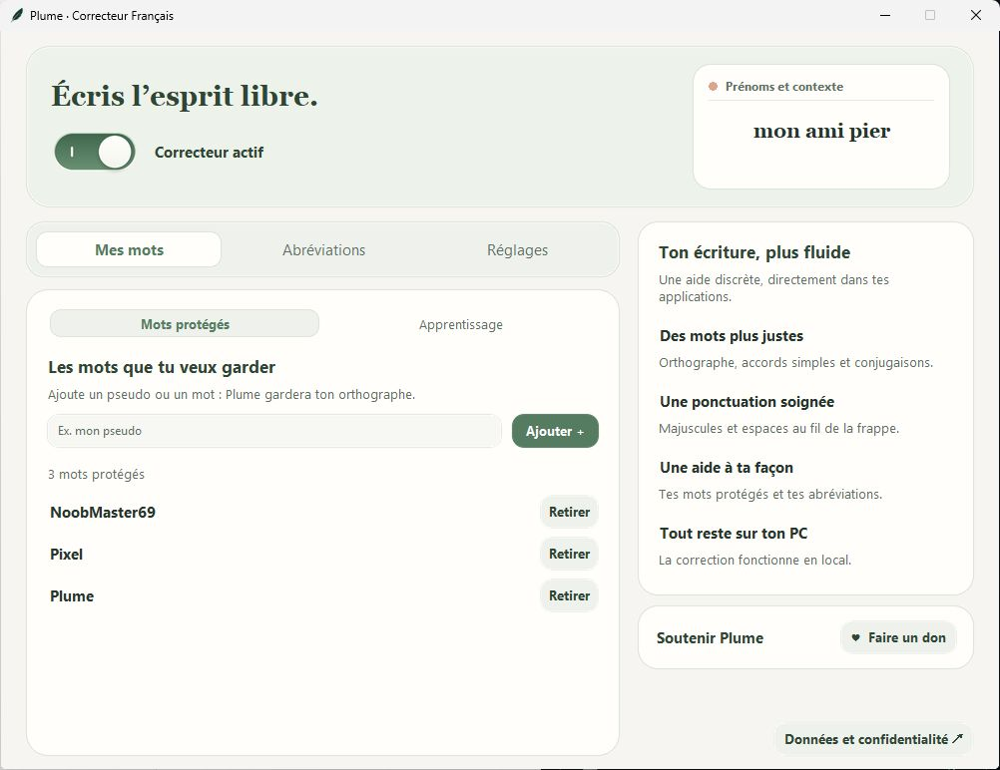
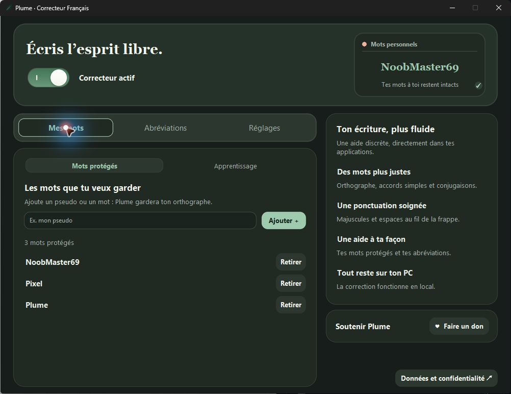
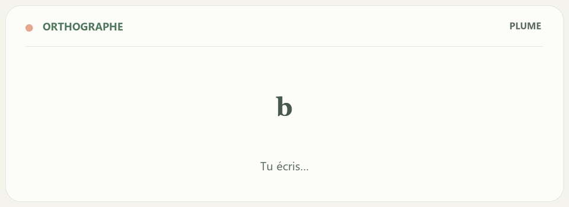
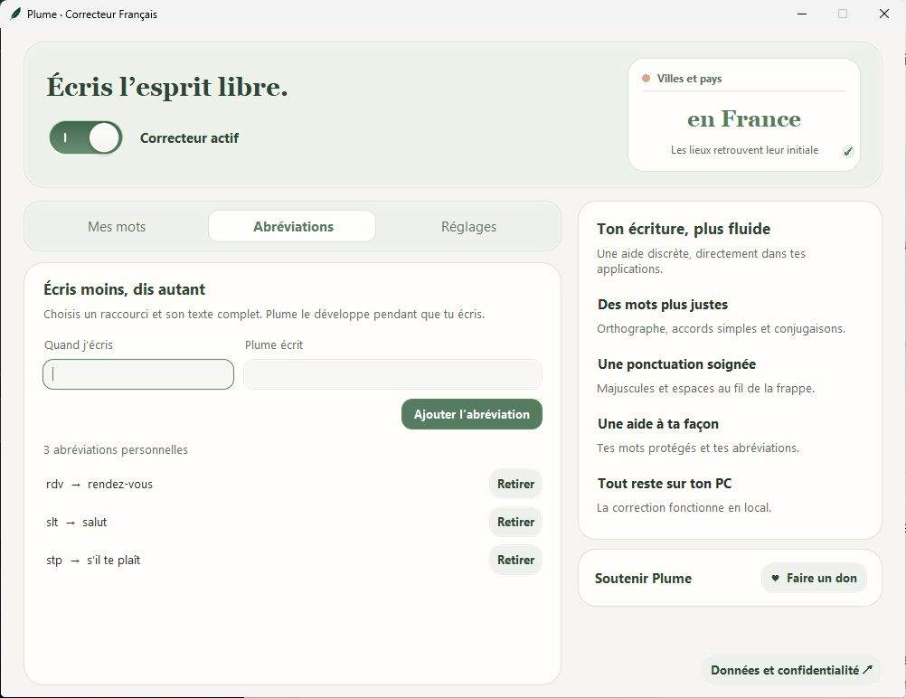
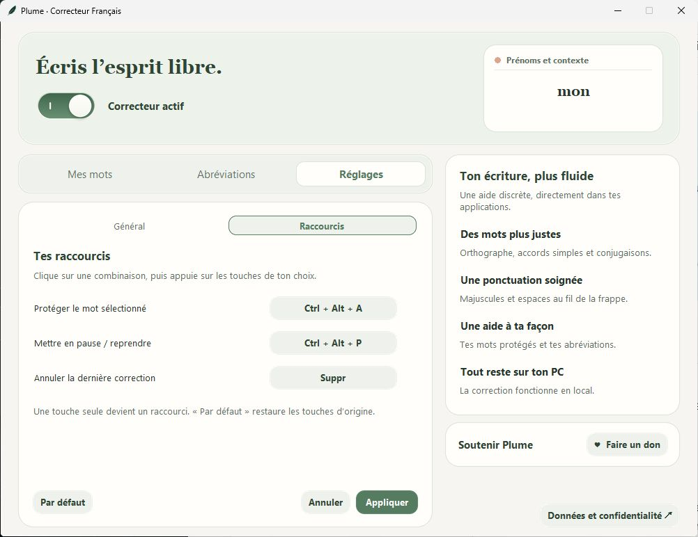

  <a href="https://github.com/d4vd97kat/Plume-Downloads/releases/latest/download/Plume-windows-x64.zip"><strong>↓ Télécharger Plume pour Windows</strong></a>
  &nbsp; · &nbsp;
  <a href="#bien-démarrer">Bien démarrer</a>
  &nbsp; · &nbsp;
  <a href="#une-interface-qui-va-à-lessentiel">Découvrir l'interface</a>

## Tu écris. Plume veille.

**Plume est un petit assistant gratuit qui t'aide à écrire en français sur ton ordinateur Windows.**

Tu tapes ton message comme d'habitude. Plume peut corriger un mot mal écrit, ajouter une majuscule ou remettre un espace au bon endroit. Un interrupteur permet de l'activer ou de le mettre en pause.

**Tes textes restent sur ton PC.** Les corrections se font sur ton ordinateur, sans envoyer tes messages sur Internet. Une connexion sert à télécharger Plume et ses mises à jour.

## Une interface qui va à l'essentiel

### Le mode clair

### Le mode sombre

*Captures réelles de Plume 0.1.39, avec des données d'exemple.*

Trois onglets pour trouver facilement ce dont tu as besoin :

| Onglet | À quoi il sert |
| --- | --- |
| **Mes mots** | Garder ton pseudo ou un mot personnel tel quel. Retrouver aussi les corrections mémorisées dans **Apprentissage** et les oublier une par une. |
| **Abréviations** | Choisir tes propres petits mots qui deviennent des mots complets. |
| **Réglages** | Choisir le thème, le démarrage avec Windows, les mises à jour et tes raccourcis. |

## Les petits coups de pouce de Plume

| Tu écris… | Plume peut écrire… | Le petit coup de pouce |
| --- | --- | --- |
| `bonjor` | `bonjour` | Retrouver une lettre oubliée. |
| `ddacord` | `d'accord` | Réparer une faute de frappe. |
| `bonjour. demain` | `Bonjour. Demain` | Ajouter les majuscules de début de phrase. |
| `salut,ça va?` | `Salut, ça va ?` | Espacer les mots et la ponctuation. |
| `slt` | `salut` | Utiliser une abréviation que tu as choisie. |
| `J'ai mange` | `J'ai mangé` | Aider avec certains accords et conjugaisons simples. |
| `en france` | `en France` | Reconnaître certains noms de lieux. |
| `Je mapele` | `Je m'appelle` | Retrouver le pronom et la bonne conjugaison. |
| `Il doit mapele` | `Il doit m'appeler` | Tenir compte des mots autour. |
| `a mon goût` | `à mon goût` | Choisir le bon « a / à » dans les cas reconnus. |

*L'animation montre des exemples préparés, comme la démonstration dans Plume. La correction d'un vrai message dépend aussi des mots autour. Plume progresse encore : il peut laisser passer une faute ou se tromper.*

La version **0.1.50** apporte aussi un dictionnaire plus riche, un analyseur de phrase et un modèle de correction qui fonctionne sur ton PC. Ils aident Plume à choisir certaines formes selon le sujet et les mots autour.

### Tes mots, à ta façon

Ton pseudo, par exemple **NoobMaster69**, doit rester comme tu l'as choisi. Ajoute-le dans **Mes mots** pour que Plume le garde.

Si tu annules plusieurs fois la même correction, Plume peut te proposer de retenir ton choix. Il ne le mémorise que si tu confirmes. Tu peux ensuite l'oublier dans **Mes mots → Apprentissage**.

### Écris moins, dis autant

Tu peux choisir **`slt` → `salut`**, **`stp` → `s'il te plaît`** ou **`rdv` → `rendez-vous`**. C'est toi qui ajoutes ces abréviations.

### Des raccourcis que tu choisis

Dans **Réglages → Raccourcis**, clique sur une combinaison, puis presse et relâche les touches que tu veux utiliser. Clique sur **Appliquer** pour garder ton choix. **Par défaut** permet de retrouver les touches proposées au départ.

## Bien démarrer

1. Clique sur **[Télécharger Plume pour Windows](https://github.com/d4vd97kat/Plume-Downloads/releases/latest/download/Plume-windows-x64.zip)**.
2. Dans le dossier Téléchargements, fais un clic droit sur le ZIP, puis choisis **Extraire tout**. Un ZIP est un paquet qui contient plusieurs fichiers.
3. Ouvre le dossier extrait. Garde **Plume.exe** et le dossier **_internal** ensemble : Plume a besoin des deux.
4. Double-clique sur **Plume.exe**. Active l'interrupteur si le correcteur est en pause.
5. Écris dans une application habituelle. Termine ton mot par un espace ou une ponctuation et laisse une courte pause pour les corrections de phrase.

Fermer la fenêtre peut laisser Plume actif en arrière-plan, selon tes réglages. Tu le retrouves près de l'horloge Windows : un clic gauche ouvre l'interface ; un clic droit permet de le mettre en pause ou de le quitter.

Plume est prévu pour **Windows 64 bits**. Les barres d'adresse de Brave, Chrome et Edge sont exclues de la correction automatique.

## Les mises à jour

La version disponible au téléchargement est **0.1.50** : **[voir ses nouveautés](Notes-de-version-0.1.50.md)**.

Quand la recherche automatique est activée, Plume cherche une nouvelle version à l'ouverture de son interface. S'il en trouve une, une annonce apparaît en haut. Tu choisis quand la télécharger et l'installer. Tu peux aussi vérifier depuis les réglages.

<strong>Tu as une version 0.1.25 ou plus ancienne ?</strong>

L'ancien programme de mise à jour avait un problème. Il faut donc remplacer Plume **une fois à la main** :

1. Quitte Plume depuis son icône près de l'horloge.
2. Télécharge le nouveau ZIP et choisis **Extraire tout**.
3. Remplace **Plume.exe** et **_internal** dans le dossier où tu utilises déjà Plume.
4. Relance Plume et regarde son numéro de version dans les réglages.

Tes mots, tes abréviations et tes réglages sont enregistrés dans un dossier séparé sur ton PC.

## Un souci ou une idée ?

Tu peux **[signaler un problème ou proposer une idée](https://github.com/d4vd97kat/Plume-Downloads/issues/new)**. Pour une faute mal corrigée, donne un exemple inventé avec ce que tu as écrit et ce que tu attendais. Indique aussi la version de Plume et l'application utilisée.

## Envie de soutenir Plume ?

Plume est gratuit. Si tu veux donner un petit coup de pouce à son développement, tu peux **[soutenir Plume avec PayPal](https://paypal.me/davidbavol)**.

---

Cette page contient les téléchargements, les images et les notes de version de Plume.
